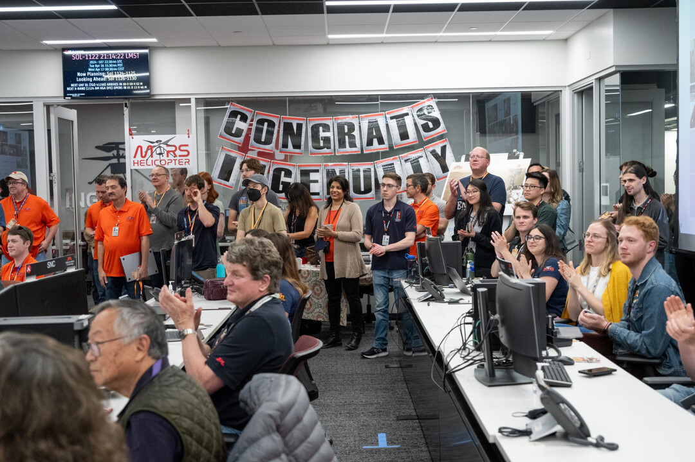

# Velatum
Minimalist face detection pipeline powered by OpenCV's YuNet.
*"Velatum" translates from Latin as "veiled" or "hidden"*

# Preview

| Before | After |
| :---: | :---: |
|  |  |

> **Note:** Original sample image was sourced from [NASA Photojournal](https://science.nasa.gov/photojournal/mars-helicopter-team-witnesses-final-downlink/) and is used under the **Fair Use** doctrine for demonstration and educational purposes.

## Setup

1. Clone this repository.

2. Install dependencies:
   ```bash
   pip install -r requirements.txt
   ```

3. Run server:
   ```bash
   uvicorn main:app --reload
   ```

4. Open API docs in browser: [`http://127.0.0.1:8000/docs`](http://127.0.0.1:8000/docs)
